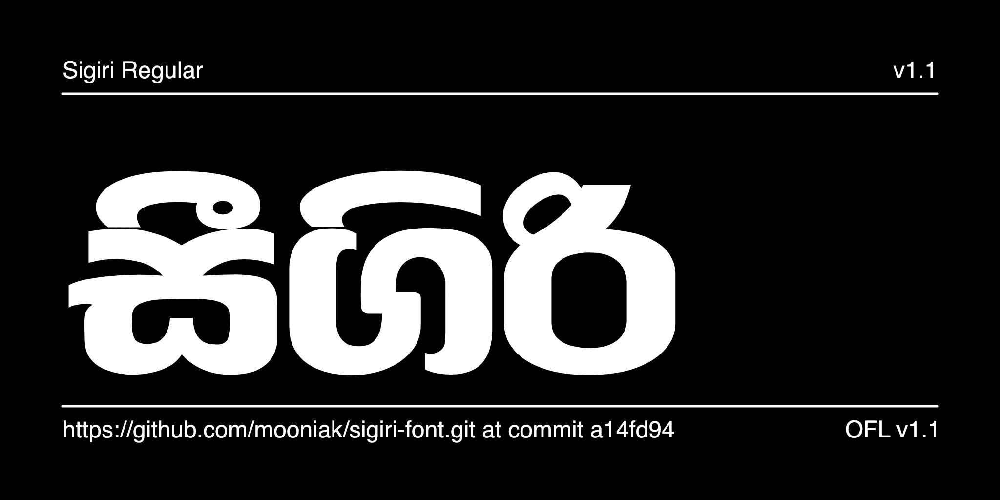
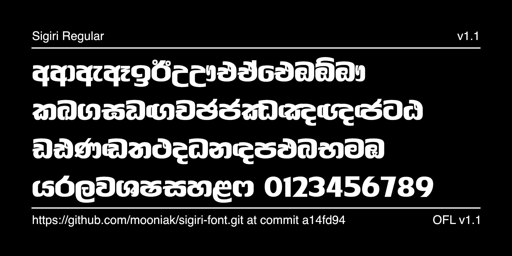

# Sigiri Font

[![Build][badge-build]][link-build]
[![Fontspector QA][badge-qa]][link-qa]
[![Release][badge-release]][link-release]
[![License: OFL 1.1][badge-license]][link-license]

[badge-build]: https://github.com/mooniak/sigiri-font/actions/workflows/build.yaml/badge.svg?branch=dev
[badge-qa]: https://img.shields.io/badge/dynamic/json?url=https%3A%2F%2Fsrc.mooniak.com%2Fsigiri-font%2Fbuild.json&query=%24.qa.pass_rate&suffix=%25&label=fontspector%20QA%20(dev%20build)&color=informational
[badge-release]: https://img.shields.io/github/v/release/mooniak/sigiri-font?label=release
[badge-license]: https://img.shields.io/badge/license-OFL--1.1-green
[link-build]: https://github.com/mooniak/sigiri-font/actions/workflows/build.yaml
[link-qa]: https://src.mooniak.com/sigiri-font/reports/fontspector/fontspector-report.html
[link-release]: https://github.com/mooniak/sigiri-font/releases
[link-license]: OFL.txt

Sigiri is a Sinhala typeface designed by Lalith Rathnayake, in a single Regular weight. It is maintained by [Mooniak](https://mooniak.com/) and distributed as a free font under the SIL Open Font License.

## About

Sigiri is maintained by [Mooniak](https://mooniak.com/), a design collective in Colombo, Sri Lanka.

## Building

Fonts are built automatically by GitHub Actions — take a look in the "Actions" tab for the latest build.

If you want to build fonts manually on your own computer:

- `make build` will produce font files.
- `make test` will run [Fontspector](https://fonttools.github.io/fontspector/)'s quality assurance tests.
- `make proof` will generate HTML proof files.

The proof files and QA reports are also produced by GitHub Actions: open the latest run in the "Actions" tab.

## Changelog

## License

This Font Software is licensed under the SIL Open Font License, Version 1.1.
This license is available with a FAQ at https://openfontlicense.org

## Repository Layout

This font repository structure is inspired by [Unified Font Repository v0.3](https://github.com/unified-font-repository/Unified-Font-Repository), modified for the Google Fonts workflow.
